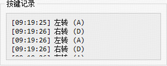

1. 【已解决】机载相机页面，未连接时显示“连接已断开\n\n连接已断开”,这个转义符没有转义，且为什么重复呢？ 
2. 【已解决】三维视图中区分不开鱼背和鱼肚子，加个背鳍好不好
3. 【已解决】键盘控制无效。
4. 【已解决】按键记录窗口太小，显示最下面的文字不全 

5. 【已解决】机器鱼上需要启动很多节点  
6. ui程序经常卡死，自动退出，内存需要优化
QObject::killTimer: Timers cannot be stopped from another thread
7. 【已解决】保存数据出错
[14:12:56] 数据更新异常: 'NoneType' object has no attribute 'tail_frequency'
8. 【已解决】位置绘图和时间序列绘图时在图上标注实时数据
9. 保存数据时显示文件夹不存在。excel数据保存不成功 No module named 'openpyxl'